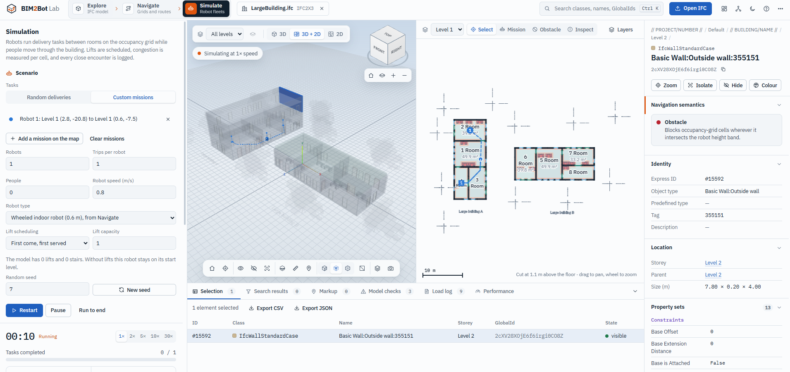

# BIM2Bot Lab

**From IFC model to robot route, entirely in the browser.**



BIM2Bot Lab is a free, client-side construction informatics lab. Open an IFC model to explore its geometry and semantics, turn it into maps a robot can plan on, and simulate robot fleets moving through the building. Every navigation result can be traced back to the IFC elements and processing steps that produced it. Nothing is uploaded: files are parsed locally with web-ifc (WebAssembly).

[](https://isaddiq.github.io/)
[](LICENSE)

---

## Workspaces

| Version | Workspace          | What it does                                                                                                                           |
| ------- | ------------------ | -------------------------------------------------------------------------------------------------------------------------------------- |
| 1       | **Explore**  | IFC viewer, semantic inspection, storeys, building intelligence, model checks                                                          |
| 2       | **Navigate** | Occupancy grids and a room graph derived from IFC, multi-level A* routes, what-if obstacles and blocked doors, cell-level traceability |
| 3       | **Simulate** | Robot fleets with lift scheduling, corridor congestion, and human–robot interaction analysis                                          |

## Views

- **3D**: left-drag orbits, right-drag pans, the wheel zooms toward the cursor, double-click zooms to an element; one-finger orbit and pinch on touch screens. A **navigation cube** jumps to any of 26 views (click a face, edge or corner) and orbits when dragged. View tools sit in one dock at the bottom; scene filters (rooms, see-through slabs, structure, MEP, exploded levels) live in its layers menu.
- **Floor plan**: a 2D plan per level, cut 1.1 m above the floor, showing walls, windows, doors, stairs, furniture, rooms with areas, the occupancy grid, routes, what-if obstacles, missions and live simulation agents. Click a line or room to select its IFC element.
- **Layouts**: switch between **3D**, **3D + 2D** (side by side) and **2D**. Room labels on the plan are fitted inside each room and never cross walls.

## Explore (Version 1)

- **Camera**: animated presets, zoom to selection, saved views.
- **Display**: shaded, X-ray and wireframe modes, edge lines, room volumes on demand, see-through slabs, exploded levels.
- **Level tools**: isolate a storey, then cut a floor plan 1.2 m above its floor.
- **Section box** with draggable faces, **measure** point to point (ΔX/ΔY/ΔZ), **pin issues** with status and priority.
- **Model browser**: spatial tree with hierarchy guides, classes with readable names and their share of the model, disciplines, an **IFC schema browser** (the model's classes in their IFC inheritance tree, with attributes, property sets and relationships per class), saved views and selection sets.
- **Inspector**: identity, location, property sets, quantities, materials, type, classification, relationships, raw STEP attributes, and the element's **navigation semantics** (how the robot pipeline reads it, and why).
- **Search** by class, name, tag, GlobalId, `#expressId`, material, storey or property (`FireRating:EI 60`).
- **Building intelligence** dashboard and data-driven **model checks**.

## Navigate (Version 2)

### Room graph

| Step                 | What happens                                                                                            | IFC source                                                                                                                        |
| -------------------- | ------------------------------------------------------------------------------------------------------- | --------------------------------------------------------------------------------------------------------------------------------- |
| S1 Level extraction  | Storeys become levels; floor elevation is measured from walkable slabs and aligned to the IFC elevation | `IfcBuildingStorey`, `IfcSlab`                                                                                                |
| S2 Region extraction | Rooms become nodes; area and centroid come from the space's floor faces                                 | `IfcSpace` geometry                                                                                                             |
| S3 Portal linking    | Doors link rooms; open-plan rooms that touch are linked directly                                        | `IfcRelSpaceBoundary` (physical and virtual), else geometry; `IfcRelFillsElement` + `IfcRelVoidsElement` give the host wall |
| S4 Vertical linking  | Stairs, ramps and lifts link the levels they span                                                       | `IfcStair`, `IfcRamp`, `IfcTransportElement`                                                                                |
| S5 Topology analysis | Weighted graph, connected components, reachability for a robot profile                                  | —                                                                                                                                |

### Occupancy grids

| Step                      | What happens                                                                                                                                                                                                     |
| ------------------------- | ---------------------------------------------------------------------------------------------------------------------------------------------------------------------------------------------------------------- |
| G1 Floor extraction       | Up-facing walkable faces (slabs, flooring, room floors) near each floor height become floor cells                                                                                                                |
| G2 Obstacle rasterisation | Every triangle is clipped to the band 0.1–2.2 m above the floor; each cell keeps the lowest obstruction height and the element that caused it, so a robot of any height can be evaluated without re-rasterising |
| G3 Door carving           | Door footprints are opened                                                                                                                                                                                       |
| G4 Robot inflation        | A distance transform marks cells closer than the robot's half-width plus clearance to an obstacle or floor edge                                                                                                  |
| G5 What-if obstacles      | User-placed obstacles and blocked doors                                                                                                                                                                          |
| G6 Path search            | 8-connected A* without corner cutting, across levels through stair and lift landings, smoothed by line of sight, with a cost that keeps robots mid-corridor                                                      |

In the Navigate workspace you can pick a robot profile (width, height, clearance, stairs, lifts), choose the room graph or the occupancy grid planner, route between rooms or between **start and goal points picked anywhere on the floor** (on the plan or the 3D floor grid), block doors, place obstacles by clicking the map, and **inspect any cell** to see which IFC element and which step made it free, blocked or too narrow. A what-if option puts a lift in every stair core. **Simulate this route** hands the current route to the simulator as a one-robot mission.

## Simulate (Version 3)

A deterministic, seeded, fixed-step simulation on the occupancy grids:

- **Fleet**: up to 8 robots run random delivery tasks between rooms, or **custom missions**: click a start and a goal on the plan or the 3D floor grid for each robot, and it shuttles between them. Routes are re-planned on the grid for every trip, and each mission and robot path is drawn along its real A* route.
- **Lifts**: each lift (or what-if lift) has a car with travel speed, door dwell time and capacity, scheduled first come first served or by nearest car with collective stops.
- **Congestion**: robots never move closer than one body width to another; the robot with right of way tries a local detour, and true head-on conflicts are resolved and counted as deadlocks. Waiting time is accumulated per cell and shown as a heatmap and a ranked list of hotspots.
- **Human–robot interaction**: people walk between rooms. Robots slow inside a 2 m detection radius and stop inside a 0.8 m safety radius; people give way and step aside when a robot is stuck. Encounters, near misses, the closest approach, and every safety event are logged with time and place.
- **Results**: makespan, throughput, mean task time, distance, congestion and lift waits, per-robot and per-lift tables, and a JSON export with the scenario, summary and event log.

What-if obstacles and blocked doors from Navigate apply to the simulation too.

## Sample models

| Sample                                                              | Contents                                                   | Source and licence                                                                                                                                                                                          |
| ------------------------------------------------------------------- | ---------------------------------------------------------- | ----------------------------------------------------------------------------------------------------------------------------------------------------------------------------------------------------------- |
| **Office blocks** (`assets/ifc/LargeBuilding.ifc`, bundled) | 2 storeys, 8 rooms, 18 doors, furniture                    | [BIM Whale samples](https://github.com/andrewisen/bim-whale-ifc-samples) by André Wisén, MIT licence (see `assets/ifc/LICENSE-LargeBuilding.txt`)                                                        |
| **Duplex apartment** (downloaded on demand)                   | 2 units over 2 storeys, 21 rooms, stairs, space boundaries | Common BIM Files (NIBS buildingSMART alliance / US Army ERDC). Not redistributed here: the browser fetches it from a [public GitHub mirror](https://github.com/youshengCode/IfcSampleFiles) when you open it |

## Architecture

```text
index.html                       Loads React 18 (UMD), Three.js 0.160 (ESM), then the compiled scripts in order
assets/
  css/main.css                   Design tokens (light/dark), layout and components
  ifc/                           Bundled sample model and its licence
  logos/bim2bot-mark.svg         Logo and favicon
  js/
    core/schema.jsx              IFC class catalogue, colours, disciplines, NAV_ROLES, schema docs
    core/ifcloader.jsx           web-ifc bootstrap + parseIfcBuffer(): pure parser, no DOM
    core/building.jsx            Room graph, readiness report, graph routing (S1–S5)
    core/navmap.jsx              Occupancy grids, robot inflation, multi-level A*, cell traceability (G1–G6)
    core/simulation.jsx          Multi-robot simulation engine (fleet, missions, lifts, congestion, people)
    core/plan.jsx                2D floor plans: geometry sliced at the plan cut, rooms, doors, stairs
    viewer/viewer.jsx            ThreeViewer: render-on-demand scene, picking, section box, plan cut, overlays, frame hook
    viewer/overlays.jsx          Room graph, routes, occupancy grids, heatmaps, markers and simulated agents
    viewer/viewcube.jsx          Navigation cube (26 views, drag to orbit)
    ui/icons.jsx                 Inline SVG icon set
    ui/panels.jsx                Model browser, inspector, bottom panel, schema explorer
    ui/navigation.jsx            Navigate workspace and Building intelligence dashboard
    ui/simulate.jsx              Simulate workspace and the useSimulation hook
    ui/planview.jsx              2D floor-plan viewer (canvas, pan/zoom, map tools)
    app.jsx                      App shell, state and wiring
    compiled/                    Built IIFE scripts (checked in so the site needs no build to serve)
    ifc-loader-bundle.js         Bundled web-ifc-three runtime
    web-ifc-0.0.35/              web-ifc WASM binaries
```

Everything under `core/` is free of DOM and Three.js dependencies, so it runs in Node tests or a Web Worker unchanged.

### Extension points

| Need                     | API                                                                                                                        |
| ------------------------ | -------------------------------------------------------------------------------------------------------------------------- |
| Draw on the model        | `viewer.setOverlay(name, object3D, { pickable })`, `viewer.removeOverlay(name)`; coordinates are model space           |
| Animate                  | `viewer.onFrame((dt, t) => …)`; the viewer renders continuously only while listeners exist                              |
| Floor-plan views         | `viewer.setPlanCut({ enabled, y })`                                                                                      |
| Interpret an IFC element | `navRoleOf(element)` and `NAV_ROLES` in `core/schema.jsx`                                                            |
| Maps for a robot         | `buildNavMap(model, building)` once, then `applyRobot(navMap, building, robot, { blocked, obstacles, stairsAsLifts })` |
| Plan                     | `planGridRoute(state, from, to, { extraCost })` or `findRoute(graph, fromRoom, toRoom, { robot, blocked })`            |
| Explain a map cell       | `explainCell(state, levelId, x, z)`                                                                                      |
| Simulate                 | `createSimulation({ model, building, navMap }, scenario)`, then `step(dt)`, `runToEnd()`, `summary()`              |

## Run locally

A local HTTP server is required: `file://` URLs block WASM and the sample fetch.

```bash
npx serve .            # or: python -m http.server 8080
```

## Rebuild after editing JSX

```bash
npm run build
```

This runs esbuild once over all sources (`npx` fetches esbuild; no `npm install` needed). Commit the updated files in `assets/js/compiled/`.

## IFC support

IFC2x3, IFC4 and IFC4.3 STEP files (`.ifc`). Elements of classes outside the built-in catalogue are still loaded from the geometry stream and listed under Model checks. Room-level navigation needs `IfcSpace` elements; the occupancy grid works from walls, slabs and furniture alone.

## Tech stack

| Layer   | Library                                        |
| ------- | ---------------------------------------------- |
| UI      | React 18.3.1 (UMD), compiled with esbuild      |
| 3D      | Three.js 0.160.0                               |
| IFC     | web-ifc 0.0.35 (WASM)                          |
| Fonts   | IBM Plex Sans and IBM Plex Mono (Google Fonts) |
| Hosting | GitHub Pages (static)                          |

## Author

**Saddiq** — [isaddiq.github.io](https://isaddiq.github.io/)
