<div align="center">

<a href="https://isaddiq.github.io/BIM2Bot-Lab/">
  <picture>
    <source media="(prefers-color-scheme: dark)" srcset="assets/logos/bim2bot-wordmark-dark.svg" />
    
  </picture>
</a>

**From IFC model to robot route, entirely in the browser.**

[](https://isaddiq.github.io/BIM2Bot-Lab/)

[](LICENSE)
[](https://react.dev/)
[](https://threejs.org/)
[](https://github.com/ThatOpen/engine_web-ifc)
[](https://technical.buildingsmart.org/standards/ifc/)
[](#navigate)
[](#privacy)

[Open the app](https://isaddiq.github.io/BIM2Bot-Lab/) ·
[At a glance](#at-a-glance) ·
[How it works](#how-it-works) ·
[Robots](#robots) ·
[Sample models](#sample-models) ·
[Architecture](#architecture) ·
[Run locally](#run-locally)

<br />

<a href="https://isaddiq.github.io/BIM2Bot-Lab/">
  <picture>
    <source media="(prefers-color-scheme: dark)" srcset="assets/images/readme/home-page-dark.webp" />
    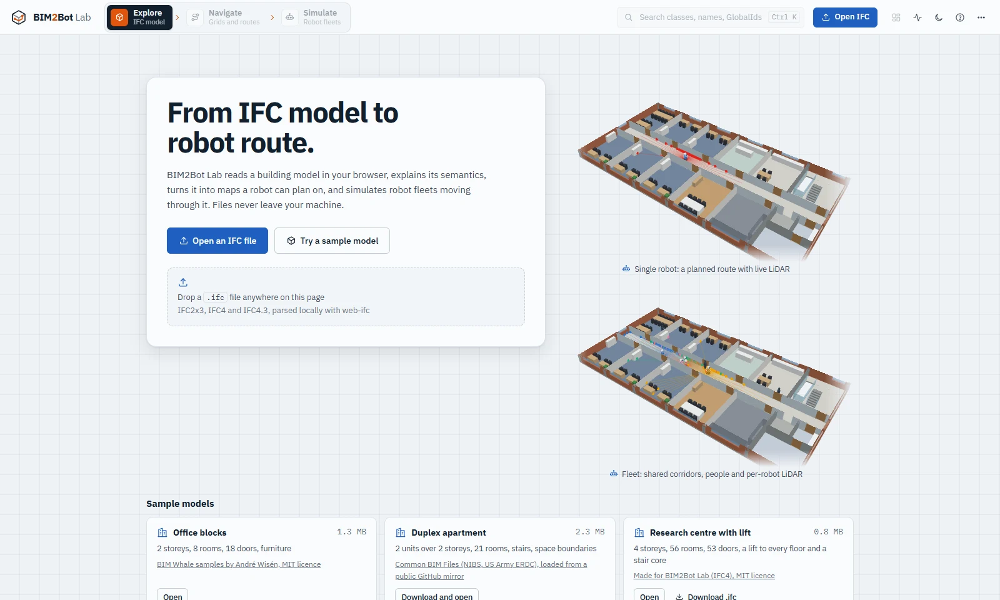
  </picture>
</a>

</div>

<table>
  <tr>
    <td width="50%" align="center">
      <picture>
        <source media="(prefers-color-scheme: dark)" srcset="assets/images/home/sim-single-dark.gif" />
        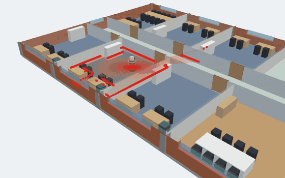
      </picture>
      <br /><sub><b>One robot</b>, a planned A* route and its live LiDAR scan (1× speed)</sub>
    </td>
    <td width="50%" align="center">
      <picture>
        <source media="(prefers-color-scheme: dark)" srcset="assets/images/home/sim-fleet-dark.gif" />
        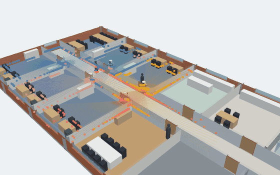
      </picture>
      <br /><sub><b>A fleet</b> sharing corridors with people, each LiDAR in its robot's colour (1× speed)</sub>
    </td>
  </tr>
</table>

BIM2Bot Lab is a free construction informatics lab that runs in the browser. Open an IFC model to explore its geometry and semantics, turn it into maps a robot can plan on, and simulate robot fleets moving through the building. **Every navigation result can be traced back to the IFC elements and processing steps that produced it.**

<a id="privacy"></a>🔒 Nothing is uploaded. Files are parsed on your device with web-ifc (WebAssembly).

## At a glance

The app has three workspaces, one for each version of the project plan. Every panel section has an <kbd>ⓘ</kbd> button that explains what it does.

<table>
  <tr>
    <th width="33%">🧭 Explore <sub>(V1)</sub></th>
    <th width="33%">🗺️ Navigate <sub>(V2)</sub></th>
    <th width="33%">🤖 Simulate <sub>(V3)</sub></th>
  </tr>
  <tr valign="top">
    <td>
      <ul>
        <li>3D model and 2D floor plans side by side</li>
        <li>Spatial tree, property sets, materials, relationships</li>
        <li>IFC schema browser</li>
        <li>Layers and category filters, section box, plan cut</li>
        <li>Measure, pin issues, saved views</li>
        <li>Building intelligence and model checks</li>
      </ul>
    </td>
    <td>
      <ul>
        <li>Room graph and occupancy grids from IFC</li>
        <li>Multi-level A* through stairs and lifts</li>
        <li>Cell-level traceability to IFC</li>
        <li>What-if obstacles and blocked doors</li>
        <li>🆕 Safety zones (no-go, slow)</li>
        <li>🆕 Route comparison: time and energy</li>
        <li>🆕 <b>ROS 2 export</b>: Nav2 PGM + YAML and waypoints</li>
      </ul>
    </td>
    <td>
      <ul>
        <li>Fleets of up to 8 robots, or custom missions</li>
        <li>Lift scheduling, congestion heatmaps</li>
        <li>People, near misses and safety log</li>
        <li>🆕 3D robot models per robot profile</li>
        <li>🆕 Simulated 2D LiDAR on every robot</li>
        <li>🆕 Door schedules with re-planning</li>
        <li>🆕 Batch experiments across seeds</li>
      </ul>
    </td>
  </tr>
</table>

<table>
  <tr>
    <td width="50%">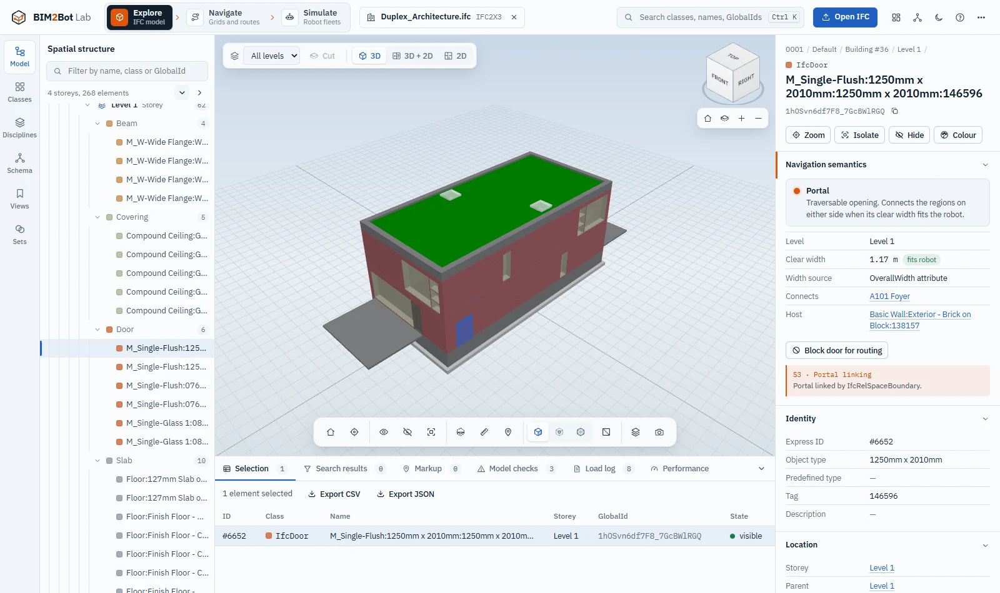</td>
    <td width="50%">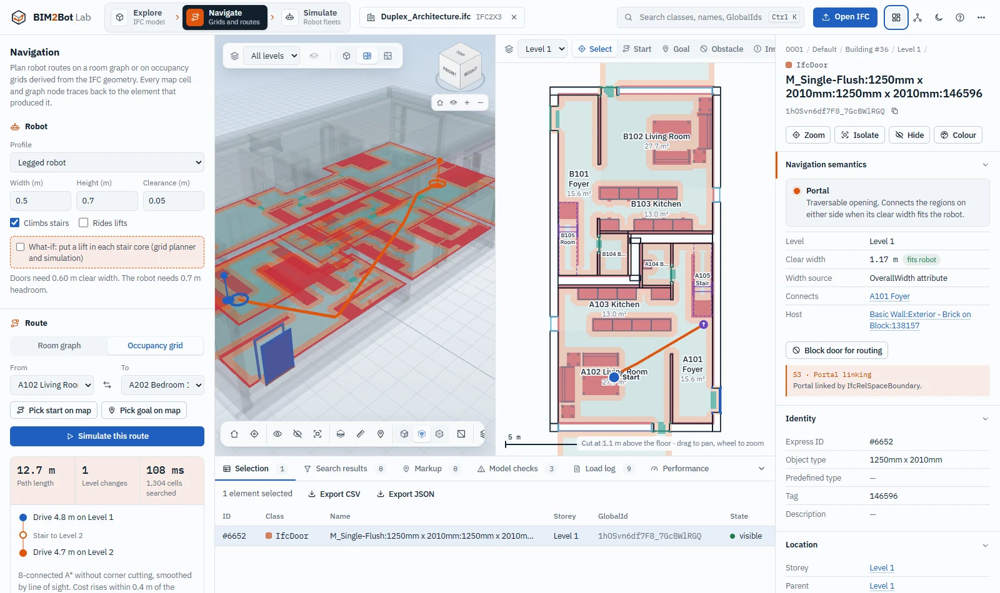</td>
  </tr>
  <tr>
    <td><b>Explore.</b> A door is selected. The inspector shows its property sets and how the robot pipeline reads it.</td>
    <td><b>Navigate.</b> A legged robot's A* route crosses two storeys by the stairs, in 3D and on the plan.</td>
  </tr>
  <tr>
    <td>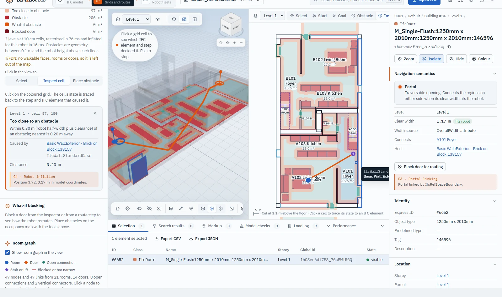</td>
    <td></td>
  </tr>
  <tr>
    <td><b>Traceability.</b> Click any grid cell to see which IFC element and which pipeline step made it free, blocked or too narrow.</td>
    <td><b>Simulate.</b> Robots and people share the duplex. The what-if option adds a lift to each stair core.</td>
  </tr>
</table>

## How it works

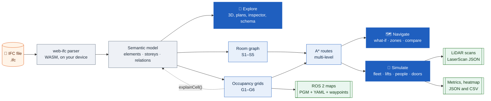

Each map cell and graph edge records the IFC element that produced it. The dotted link is the way back: from any result to the element that caused it.

<details open>
<summary><b>Room graph: S1–S5</b></summary>

| Step | What happens | IFC source |
| ---- | ------------ | ---------- |
| **S1** Levels | Storeys become levels. The floor elevation is measured from walkable slabs and aligned to the IFC elevation. | `IfcBuildingStorey`, `IfcSlab` |
| **S2** Regions | Rooms become nodes. Area and centroid come from the space's floor faces. | `IfcSpace` geometry |
| **S3** Portals | Doors link rooms. Open-plan rooms that touch are linked directly. | `IfcRelSpaceBoundary` (physical and virtual), else geometry; `IfcRelFillsElement` and `IfcRelVoidsElement` give the host wall |
| **S4** Verticals | Stairs, ramps and lifts link the levels they span. | `IfcStair`, `IfcRamp`, `IfcTransportElement` |
| **S5** Topology | The weighted graph, connected components and reachability for a robot profile. | — |

</details>

<details open>
<summary><b>Occupancy grids: G1–G6</b></summary>

| Step | What happens |
| ---- | ------------ |
| **G1** Floor | Up-facing walkable faces near each floor height become floor cells: slabs, flooring and room floors. |
| **G2** Obstacles | Every triangle is clipped to the band 0.1–2.2 m above the floor. Each cell keeps the lowest obstruction and the element that caused it, so any robot height can be checked without rasterising again. |
| **G3** Doors | Door footprints are opened. |
| **G4** Inflation | A distance transform marks cells too close to an obstacle or floor edge, using the robot's half-width plus clearance. |
| **G5** What-if | User obstacles, blocked doors and safety zones. No-go zones are hard cells; slow zones raise the travel cost in proportion to the lower speed. |
| **G6** Search | 8-connected A\* across levels through stair and lift landings, with no corner cutting, smoothed by line of sight. The cost keeps robots mid-corridor. |

</details>

## Explore

<table>
  <tr>
    <td width="50%"></td>
    <td width="50%"></td>
  </tr>
  <tr>
    <td><b>IFC schema browser.</b> The model's classes in their IFC inheritance tree, with attributes, property sets and relationships.</td>
    <td><b>Building intelligence.</b> Storeys, rooms, doors and robot readiness at a glance.</td>
  </tr>
</table>

| | |
| --- | --- |
| 🎥 **Camera** | Animated presets, zoom to selection, saved views. A navigation cube jumps to any of 26 views and orbits when you drag it. |
| 🎨 **Display** | Shaded, X-ray and wireframe, edge lines, room volumes, see-through slabs, exploded levels. |
| 🗂️ **Layers and filters** | Show or hide whole categories (architecture, structure, MEP, furnishing…), isolate structure or MEP. |
| 🏢 **Levels** | Isolate a storey, then cut a floor plan 1.2 m above its floor. |
| ✂️ **Tools** | Section box with draggable faces, point-to-point measure (ΔX/ΔY/ΔZ), pinned issues with status and priority. |
| 🔎 **Inspector** | Identity, location, type, property sets, quantities, materials, classification, relationships, raw STEP attributes, and the element's **navigation semantics**: how the robot pipeline reads it, and why. |
| 🔍 **Search** | By class, name, tag, GlobalId, `#expressId`, material, storey or property (`FireRating:EI 60`). |

<a id="navigate"></a>

## Navigate

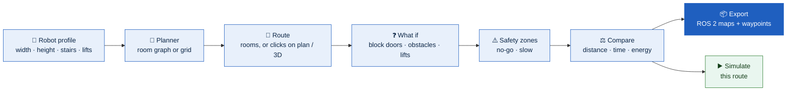

- **Inspect any cell** to see why it is free, blocked or too narrow.
- **Safety zones** are drawn with two clicks. No-go zones keep robots out; slow zones cap speed at 25, 50 or 75%.
- **Route comparison** sets the recommended route against fewest level changes, no lifts and no stairs, each with distance, estimated time and an energy estimate from coefficients you set.
- **ROS 2 export** gives one Nav2 `map_server` map per level: a binary PGM and its YAML in the trinary format `map_saver` writes, so they load without conversion. Maps use the robot's height but are not inflated, because Nav2 inflates its own costmap. A grid route adds `route_waypoints.yaml` and one `nav2_msgs/action/FollowWaypoints` goal per drive leg:

  ```bash
  ros2 action send_goal /follow_waypoints nav2_msgs/action/FollowWaypoints "$(cat route_leg_0_<map>_follow_waypoints.yaml)"
  ```

  The zip's `README.txt` lists the exact commands for your route.

  The map frame is `x = IFC X`, `y = IFC Y` after web-ifc moves the model near the origin.

## Simulate

The simulation runs on the occupancy grids. It is deterministic and seeded, with a fixed time step.

| | |
| --- | --- |
| 🤖 **Fleet** | Up to 8 robots on random deliveries, or **custom missions**: click a start and a goal and each robot shuttles between them. Every trip is re-planned on the grid and drawn along its real A\* path. |
| 🛗 **Lifts** | Cars with travel speed, door dwell and capacity, scheduled first come, first served or nearest car with collective stops. |
| 🚦 **Congestion** | Robots keep a body width apart, detour locally and resolve head-on deadlocks. Waiting time per cell becomes a heatmap and a ranked hotspot list. |
| 🚶 **People** | People walk between rooms. Robots slow within 2 m and stop within 0.8 m. Encounters, near misses and the closest approach are logged with time and place. |
| 🚪 **Door schedule** | Close doors at set times and reopen them. Robots hear about a closure from the fleet manager at once, or on arrival (onboard sensing within 3 m), then re-plan or wait. |
| ⚠️ **Safety zones** | Zones from Navigate, optional here and off by default. |
| 📡 **LiDAR** | A 2D scan on **every robot**, live in 3D and on the plan. A lone robot's rays are red; in a fleet each robot's rays take its colour. Beams stop at geometry spanning the sensor height, closed doors, obstacles, people and other robots. Scans download as `sensor_msgs/LaserScan`-shaped JSON. Simulated from the IFC grid, accurate to about one cell. |
| 🧪 **Experiments** | Vary robots, people, speed, lift policy, lift capacity or tasks over several values and seeds. Mean, standard deviation and range per value, plus a CSV of every run. |
| 📊 **Results** | Makespan, throughput, task time, distance, congestion and lift waits, re-plans, time at closed doors. Per-robot and per-lift tables and a JSON export of the scenario, summary and event log. |


When one level is shown, only the robots, people and scans on that level are drawn.

## Robots

<p align="center">
  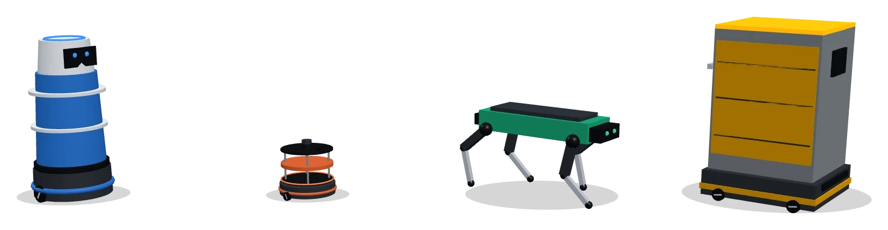
</p>

Each robot profile has its own 3D model in the simulation, coloured per robot. Wheels and LiDAR spin as the robots move, and the quadruped trots.

| Profile | Model | Width | Height | Stairs | Lifts |
| ------- | ----- | ----: | -----: | :----: | :---: |
| **Wheeled indoor robot** | Delivery robot with trays and a face screen | 0.60 m | 1.4 m | — | ✅ |
| **Compact inspection robot** | Stacked-plate research platform with a spinning LiDAR | 0.45 m | 0.6 m | — | ✅ |
| **Legged robot** | Quadruped with a trotting gait | 0.50 m | 0.7 m | ✅ | — |
| **Hospital logistics cart** | Autonomous base carrying a stainless cabinet | 0.90 m | 1.6 m | — | ✅ |
| **LionsBot R3 Vac** | Compact vacuum, box body 0.52 × 0.48 m, 53 kg | 0.48 m | 0.66 m | — | ✅ |
| **LionsBot R3 Scrub Pro** | Compact scrubber with rear squeegee, 0.64 × 0.57 m, 85.5 kg | 0.57 m | 0.83 m | — | ✅ |
| **LionsBot R5** | Floor scrubber with sensor bar and hose, 0.69 × 0.69 m, 200 kg | 0.69 m | 1.13 m | — | ✅ |
| **LionsBot S3** | Low, wide sweeper with twin side brushes and a beacon, 0.91 × 0.78 m, 80 kg | 0.78 m | 0.48 m | — | ✅ |

The LionsBot (Singapore) profiles use the body sizes and weights published on lionsbot.com. Their models are stylised from those sizes: no logos and no official CAD. Lift riding is a modelling assumption. Custom profiles pick the closest model. The models are procedural (Three.js), so the repository needs no third-party 3D assets.

**Bodies, not points.** Box-shaped robots plan with their real footprint. The planner records which of four headings the body fits in at each cell, and it checks turns on the spot at the cells where the path changes direction. Each robot also has a keep-away margin, so paths stay mid-corridor and round corners wide. Smoothing never brings a path closer to an obstacle than the search left it. The route card reports the closest approach and the IFC element responsible. In the simulation, robots turn at a limited rate and keep their footprints apart. When two robots block each other, one pulls over into free floor and lets the other pass. Any overlap of two bodies is counted as a result. The ROS 2 export includes `nav2_footprint.yaml` with the same footprint, padding and inflation radius.

## Sample models

<table>
  <tr>
    <td width="44%" align="center">
      <picture>
        <source media="(prefers-color-scheme: dark)" srcset="assets/images/readme/research-centre-dark.webp" />
        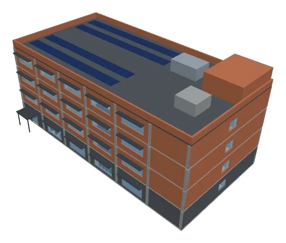
      </picture>
      <br /><sub>Research centre: 4 storeys with a lift</sub>
    </td>
    <td width="56%">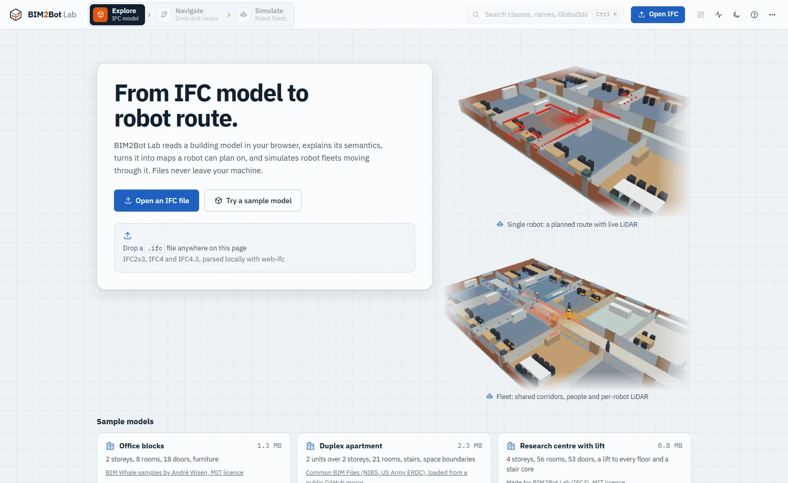</td>
  </tr>
</table>

| Sample | Contents | Best for | Source and licence |
| ------ | -------- | -------- | ------------------ |
| 🏢 **Office blocks**<br/><sub>`assets/ifc/LargeBuilding.ifc`, bundled</sub> | 2 storeys, 8 rooms, 18 doors, furniture | A quick first look | [BIM Whale samples](https://github.com/andrewisen/bim-whale-ifc-samples) by André Wisén, MIT. See `assets/ifc/LICENSE-LargeBuilding.txt`. |
| 🏠 **Duplex apartment**<br/><sub>downloaded when opened</sub> | 2 units over 2 storeys, 21 rooms, stairs, space boundaries | Stairs and space boundaries | Common BIM Files (NIBS buildingSMART alliance, US Army ERDC). Not redistributed: the browser fetches it from a [public GitHub mirror](https://github.com/youshengCode/IfcSampleFiles). |
| 🔬 **Research centre with lift**<br/><sub>`assets/ifc/ResearchCentre.ifc`, bundled and downloadable</sub> | 4 storeys, 56 rooms, 53 doors, furniture, materials, a lift to every floor, a stair core | Multi-storey routes and lift scheduling | Made for BIM2Bot Lab as IFC4 with IfcOpenShell, MIT like the code. |

You can also open your own `.ifc` file, or drop it on the window.

## Architecture

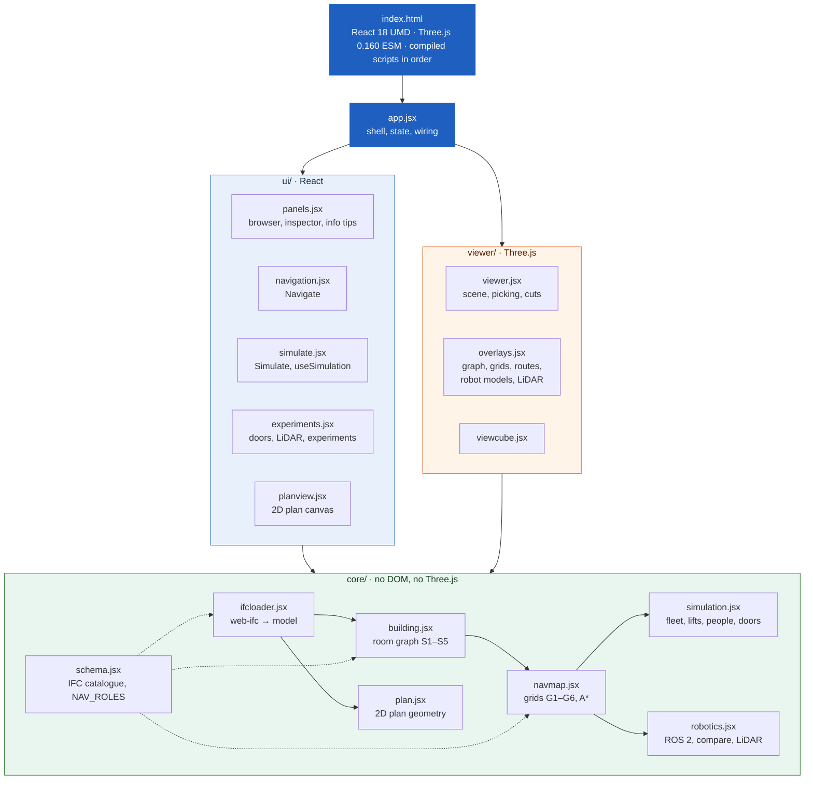

### One simulation frame

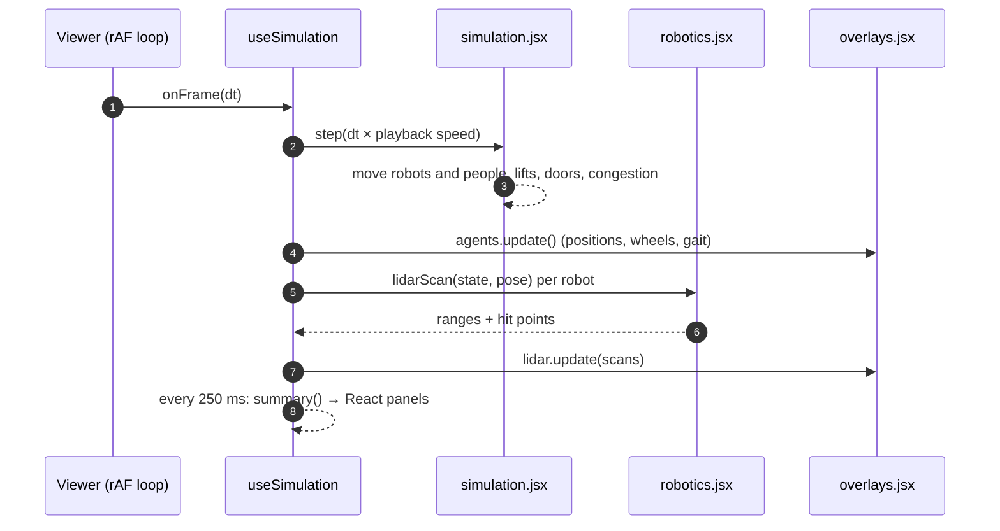

<details>
<summary><b>File map</b></summary>

```text
index.html                       Loads React 18 (UMD), Three.js 0.160 (ESM), then the compiled scripts in order
assets/
  css/main.css                   Design tokens (light/dark), layout and components
  ifc/                           Bundled sample models and licences
  images/home/                   Start-page simulation GIFs (light and dark)
  images/readme/                 README screenshots and renders
  logos/                         Mark (favicon) and wordmarks (light/dark)
  js/
    core/schema.jsx              IFC class catalogue, colours, disciplines, NAV_ROLES, schema docs
    core/ifcloader.jsx           web-ifc bootstrap and parseIfcBuffer(): a pure parser with no DOM
    core/building.jsx            Room graph, readiness report, graph routing (S1–S5)
    core/navmap.jsx              Occupancy grids, robot inflation, multi-level A*, cell traceability (G1–G6)
    core/simulation.jsx          Multi-robot simulation engine (fleet, missions, lifts, congestion, people)
    core/plan.jsx                2D floor plans: geometry sliced at the plan cut, rooms, doors, stairs
    core/robotics.jsx            ROS 2 map export (PGM + YAML, zip), route comparison, simulated 2D LiDAR
    viewer/viewer.jsx            ThreeViewer: render-on-demand scene, picking, section box, plan cut, overlays
    viewer/overlays.jsx          Room graph, routes, grids, heatmaps, markers, robot models, people, LiDAR
    viewer/viewcube.jsx          Navigation cube (26 views, drag to orbit)
    ui/icons.jsx                 Inline SVG icon set
    ui/panels.jsx                Model browser, schema browser, inspector, info tips, floating panels
    ui/navigation.jsx            Navigate workspace and Building intelligence dashboard
    ui/experiments.jsx           Door schedule, simulated LiDAR controls, batch experiments
    ui/simulate.jsx              Simulate workspace and the useSimulation hook
    ui/planview.jsx              2D floor-plan viewer (canvas, pan and zoom, map tools)
    app.jsx                      App shell, state and wiring
    compiled/                    Built IIFE scripts, checked in so the site needs no build step to serve
    ifc-loader-bundle.js         Bundled web-ifc runtime
    web-ifc-0.0.35/              web-ifc WASM binaries
```

Nothing under `core/` depends on the DOM or Three.js, so it runs unchanged in Node tests or in a Web Worker.

</details>

<details>
<summary><b>Extension points</b></summary>

| Need | API |
| ---- | --- |
| Draw on the model | `viewer.setOverlay(name, object3D, { pickable })` and `viewer.removeOverlay(name)`. Model-space coordinates; set `object3D.userData.noClip` to stay whole under a plan cut. |
| Animate | `viewer.onFrame((dt, t) => …)`. The viewer renders continuously only while listeners exist. |
| Floor-plan views | `viewer.setPlanCut({ enabled, y })` |
| Interpret an IFC element | `navRoleOf(element)` and `NAV_ROLES` in `core/schema.jsx` |
| Maps for a robot | `buildNavMap(model, building)` once, then `applyRobot(navMap, building, robot, { blocked, obstacles, zones, stairsAsLifts })` |
| Plan | `planGridRoute(state, from, to, { extraCost, avoid, transitionPenalty })` or `findRoute(graph, fromRoom, toRoom, { robot, blocked })` |
| Compare routes | `compareRoutes(state, from, to, { speed, driveWhPerM, … })` |
| Export to ROS 2 | `exportRosMaps(state, { includeZones, voidAs, route })`, then `makeZip(files)` |
| Simulated LiDAR | `lidarScan(state, { levelId, x, z, heading }, { beams, fov, range, mountHeight, noise }, people)` |
| Explain a map cell | `explainCell(state, levelId, x, z)` |
| Simulate | `createSimulation({ model, building, navMap }, scenario)`, then `step(dt)`, `runToEnd()` and `summary()`. The scenario takes `zones` with `applyZones`, and `doorEvents: [{ doorId, closeAt, openAt }]` with `doorInfo: 'fleet' \| 'onboard'` |
| Robot models | `buildRobotModel(kind, width, color)` with `kind` one of `wheeled`, `compact`, `legged`, `wide` |
| Record demos | Open `index.html?capture=1`: `window.__bim2botCapture` steps a paused simulation frame by frame (`step`, `start`, `rooms`, `cut`, `look`) for smooth 1× recordings |

</details>

## Run locally

You need a local HTTP server, because `file://` URLs block WASM and the sample download.

```bash
git clone https://github.com/isaddiq/BIM2Bot-Lab.git
cd BIM2Bot-Lab
npx serve .            # or: python -m http.server 8080
```

After editing any `.jsx` file, rebuild and commit the updated files in `assets/js/compiled/`:

```bash
npm run build          # esbuild via npx, no npm install needed
```

## IFC support

| | |
| --- | --- |
| **Schemas** | IFC2x3, IFC4 and IFC4.3 STEP files (`.ifc`) |
| **Unknown classes** | Still loaded from the geometry stream and listed under Model checks |
| **Room-level navigation** | Needs `IfcSpace` elements |
| **Occupancy grid** | Works from walls, slabs and furniture alone |
| **Lifts** | `IfcTransportElement` spanning the levels it serves; without lifts, try the "lift in each stair core" what-if |

## Tech stack

| Layer | Library |
| ----- | ------- |
| UI | React 18.3.1 (UMD), compiled with esbuild |
| 3D | Three.js 0.160.0 |
| IFC | web-ifc 0.0.35 (WASM) |
| Fonts | IBM Plex Sans and IBM Plex Mono (Google Fonts) |
| Hosting | GitHub Pages (static) |

## Citation

If you use BIM2Bot Lab in research, please cite it:

```bibtex
@software{bim2bot_lab,
  author = {Saddiq},
  title  = {{BIM2Bot Lab}: From IFC model to robot route in the browser},
  year   = {2026},
  url    = {https://github.com/isaddiq/BIM2Bot-Lab}
}
```

## Licence and author

The code is released under the [MIT licence](LICENSE). The Office blocks sample keeps its own MIT licence (`assets/ifc/LICENSE-LargeBuilding.txt`); the Research centre sample is MIT like the code.

Made by **Saddiq** · [isaddiq.github.io](https://isaddiq.github.io/)
