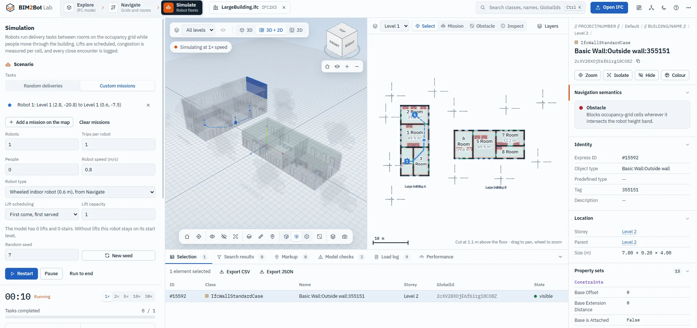
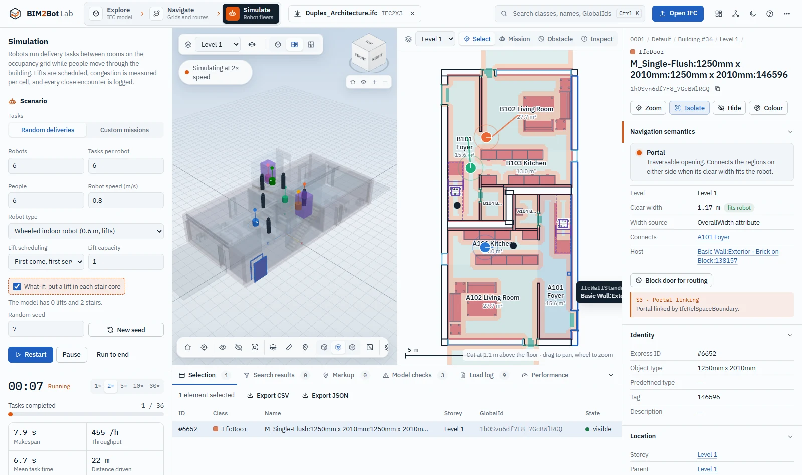
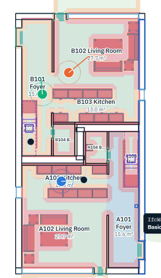
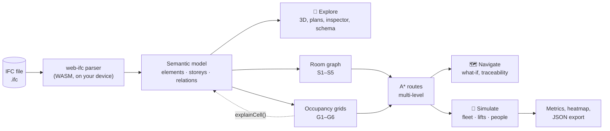
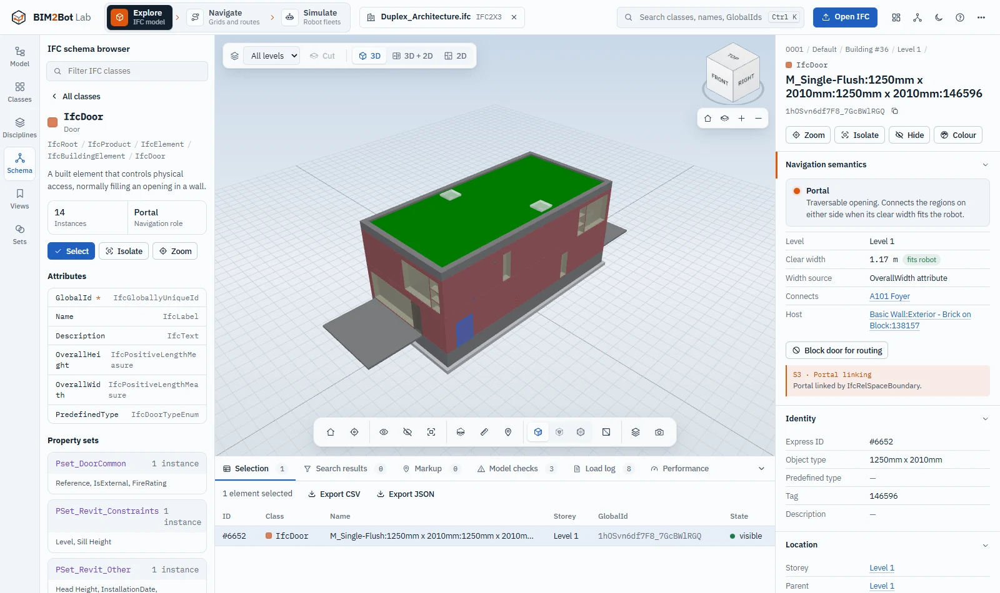
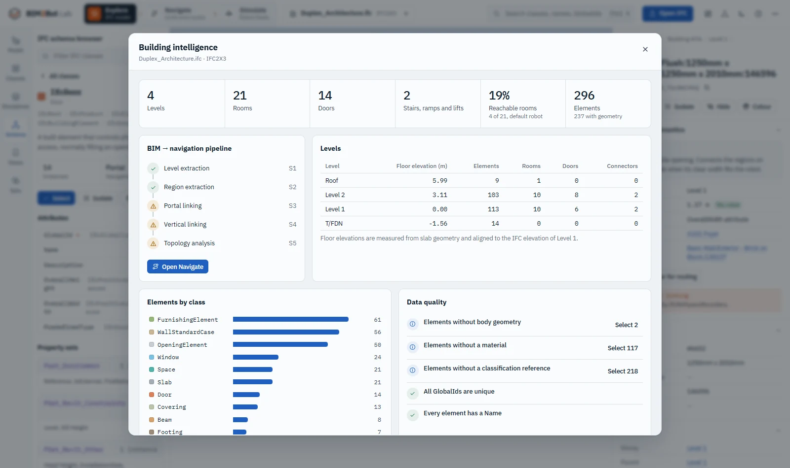
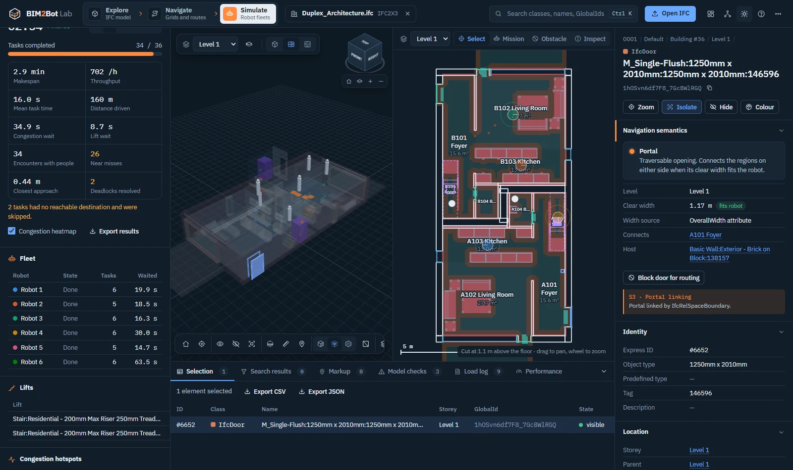
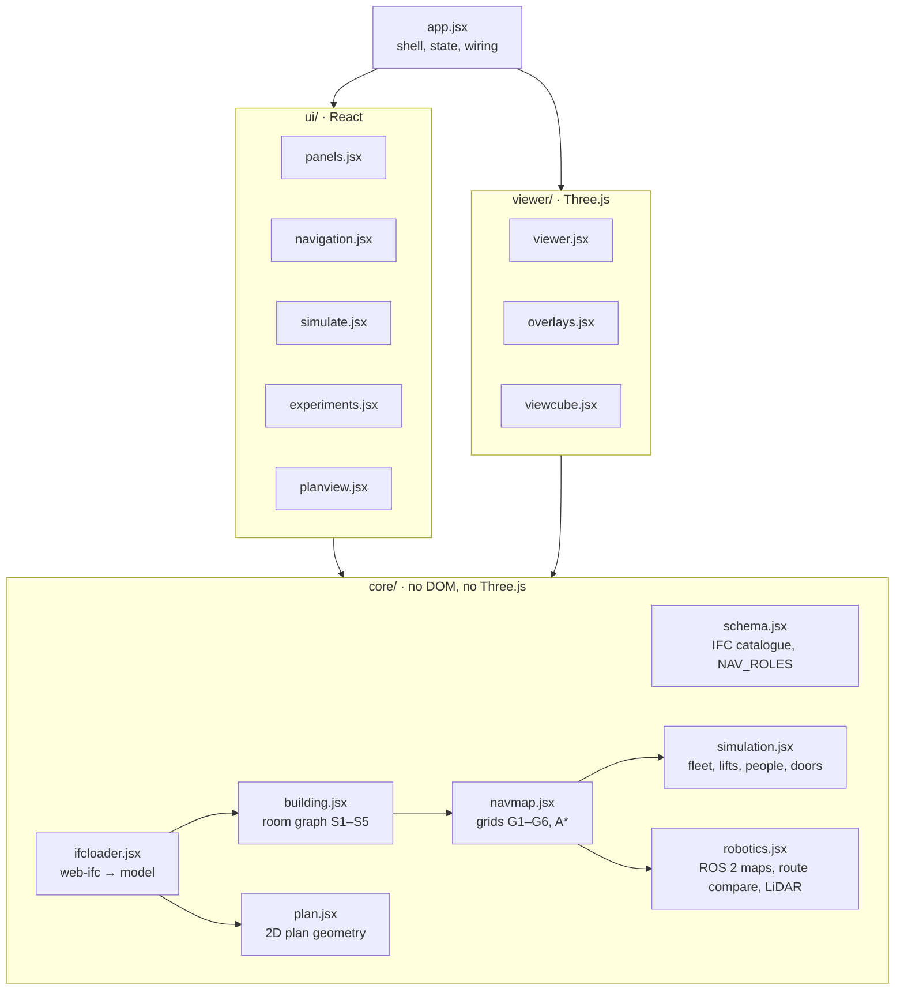

<div align="center">

<a href="https://isaddiq.github.io/BIM2Bot-Lab/">
  <picture>
    <source media="(prefers-color-scheme: dark)" srcset="assets/logos/bim2bot-wordmark-dark.svg" />
    
  </picture>
</a>

**From IFC model to robot route, entirely in the browser.**

[](https://isaddiq.github.io/BIM2Bot-Lab/)

[](LICENSE)
[](https://react.dev/)
[](https://threejs.org/)
[](https://github.com/ThatOpen/engine_web-ifc)
[](https://technical.buildingsmart.org/standards/ifc/)
[](#privacy)

[Open the app](https://isaddiq.github.io/BIM2Bot-Lab/) ·
[Workspaces](#workspaces) ·
[How it works](#how-it-works) ·
[Run locally](#run-locally) ·
[Architecture](#architecture)

</div>



BIM2Bot Lab is a free construction informatics lab that runs in the browser. Open an IFC model to explore its geometry and semantics, turn it into maps a robot can plan on, and simulate robot fleets moving through the building. Every navigation result can be traced back to the IFC elements and processing steps that produced it.

<a id="privacy"></a>Nothing is uploaded. Files are parsed on your device with web-ifc (WebAssembly).

## Workspaces

The app has three workspaces, one for each version of the project plan. The workspace switch sits at the top of the screen.

| Version | Workspace | What it does |
| :-----: | --------- | ------------ |
| **1** | 🧭 **Explore** | IFC viewer, semantic inspection, storeys, building intelligence, model checks |
| **2** | 🗺️ **Navigate** | Occupancy grids and a room graph derived from IFC, multi-level A\* routes, what-if obstacles and blocked doors, safety zones, route comparison, ROS 2 map export, cell-level traceability |
| **3** | 🤖 **Simulate** | Robot fleets with lift scheduling, corridor congestion, human–robot interaction, door schedules with re-planning, simulated LiDAR and batch experiments |

<table>
  <tr>
    <td width="50%"></td>
    <td width="50%"></td>
  </tr>
  <tr>
    <td><b>Explore.</b> A door is selected. The inspector shows its property sets and how the robot pipeline reads it.</td>
    <td><b>Navigate.</b> A legged robot's A* route crosses two storeys by the stairs. It is shown in 3D and on the plan.</td>
  </tr>
  <tr>
    <td></td>
    <td></td>
  </tr>
  <tr>
    <td><b>Traceability.</b> Click any grid cell to see which IFC element and which pipeline step made it free, blocked or too narrow.</td>
    <td><b>Simulate.</b> Six robots and six people share the duplex. The what-if option adds a lift to each stair core.</td>
  </tr>
</table>

<div align="center">
  
  <br />
  <sub>Live agents on the 2D plan. Each robot follows its own A* path through the doors.</sub>
</div>

## How it works



Each map cell and graph edge records the IFC element that produced it. Use the dotted link in the diagram to go from a result back to the IFC model.

### Room graph

| Step | What happens | IFC source |
| ---- | ------------ | ---------- |
| **S1** Level extraction | Storeys become levels. The floor elevation is measured from walkable slabs and aligned to the IFC elevation. | `IfcBuildingStorey`, `IfcSlab` |
| **S2** Region extraction | Rooms become nodes. Area and centroid come from the space's floor faces. | `IfcSpace` geometry |
| **S3** Portal linking | Doors link rooms. Open-plan rooms that touch are linked directly. | `IfcRelSpaceBoundary` (physical and virtual), else geometry. `IfcRelFillsElement` and `IfcRelVoidsElement` give the host wall. |
| **S4** Vertical linking | Stairs, ramps and lifts link the levels they span. | `IfcStair`, `IfcRamp`, `IfcTransportElement` |
| **S5** Topology analysis | Builds the weighted graph, connected components and reachability for a robot profile. | — |

### Occupancy grids

| Step | What happens |
| ---- | ------------ |
| **G1** Floor extraction | Up-facing walkable faces near each floor height become floor cells. These are slabs, flooring and room floors. |
| **G2** Obstacle rasterisation | Every triangle is clipped to the band 0.1–2.2 m above the floor. Each cell keeps the lowest obstruction height and the element that caused it, so a robot of any height can be checked without rasterising again. |
| **G3** Door carving | Door footprints are opened. |
| **G4** Robot inflation | A distance transform marks cells that are too close to an obstacle or floor edge. The limit is the robot's half-width plus its clearance. |
| **G5** What-if obstacles | Adds user-placed obstacles, blocked doors and safety zones. No-go zones are hard cells, inflated like walls. Slow zones keep their cells free but raise the travel cost in proportion to the lower speed. |
| **G6** Path search | 8-connected A\* across levels, through stair and lift landings, with no corner cutting. Paths are smoothed by line of sight. The cost keeps robots in the middle of corridors. |

## Explore (Version 1)

<table>
  <tr>
    <td width="50%"></td>
    <td width="50%"></td>
  </tr>
  <tr>
    <td><b>IFC schema browser.</b> The model's classes appear in their IFC inheritance tree. Each class shows its attributes, property sets and relationships.</td>
    <td><b>Building intelligence.</b> A dashboard of storeys, rooms, doors and robot readiness.</td>
  </tr>
</table>

- **Camera.** Animated presets, zoom to selection and saved views. A navigation cube jumps to any of 26 views and orbits when you drag it.
- **Display.** Shaded, X-ray and wireframe modes, edge lines, room volumes on demand, see-through slabs and exploded levels.
- **Level tools.** Isolate a storey, then cut a floor plan 1.2 m above its floor.
- **Section box** with draggable faces, point-to-point **measure** (ΔX/ΔY/ΔZ), and **pinned issues** with status and priority.
- **Model browser.**
  - A spatial tree with hierarchy guides.
  - Classes with readable names and their share of the model.
  - Disciplines, the IFC schema browser, saved views and selection sets.
- **Inspector.** Shows the element's:
  - identity, location and type;
  - property sets, quantities and materials;
  - classification, relationships and raw STEP attributes;
  - **navigation semantics**: how the robot pipeline reads the element, and why.
- **Search** by class, name, tag, GlobalId, `#expressId`, material, storey or property (`FireRating:EI 60`).
- **Building intelligence** dashboard and data-driven **model checks**.

## Navigate (Version 2)

1. **Pick a robot profile.** Set the width, height and clearance, and whether the robot can use stairs and lifts.
2. **Pick a planner.** Choose the room graph or the occupancy grid.
3. **Route.** Choose two rooms, or click a start and a goal anywhere on the floor. You can click on the 2D plan or on the 3D floor grid.
4. **Ask what if.** Block doors, place obstacles by clicking the map, or add a lift to every stair core.
5. **Inspect any cell.** See why it is free, blocked or too narrow.
6. **Draw safety zones.** Two clicks on the grid or the plan draw a rectangle. **No-go zones** keep robots out. **Slow zones** cap the speed at 25, 50 or 75%, and routes avoid them when that is faster.
7. **Compare routes.** For the same start and goal, compare the recommended route with the fewest level changes, no lifts and no stairs. Each shows distance, estimated time (lift rides and stairs as in Simulate) and an energy estimate from coefficients you set for your robot.
8. **Export for ROS 2.** Download one Nav2 `map_server` map per level: a binary PGM and its YAML, the same trinary format `map_saver` writes, so they load without conversion. Maps use the robot's height but are not inflated, because Nav2 inflates its own costmap. The current route comes as `route_waypoints.yaml`, plus one ready `nav2_msgs/action/FollowWaypoints` goal per drive leg (`ros2 action send_goal /follow_waypoints … "$(cat file)"`). The map frame is `x = IFC X`, `y = IFC Y` after web-ifc moves the model near the origin.
9. **Simulate this route.** The current route goes to the simulator as a one-robot mission.

## Simulate (Version 3)

The simulation runs on the occupancy grids. It is deterministic and seeded, with a fixed time step.

| | |
| --- | --- |
| 🤖 **Fleet** | Up to 8 robots. They can run random delivery tasks between rooms. They can also run **custom missions**: click a start and a goal for each robot, and it shuttles between them. Routes are planned again on the grid for every trip, and every path is drawn along its real A\* route. |
| 🛗 **Lifts** | Each lift (or what-if lift) has a car with a travel speed, a door dwell time and a capacity. Lifts are scheduled first come, first served or by nearest car with collective stops. |
| 🚦 **Congestion** | Robots keep one body width apart. The robot with right of way tries a local detour. True head-on conflicts are resolved and counted as deadlocks. Waiting time per cell becomes a heatmap and a ranked list of hotspots. |
| 🚶 **People** | People walk between rooms. Robots slow down within 2 m of a person and stop within 0.8 m. People give way and step aside when a robot is stuck. Encounters, near misses, the closest approach and every safety event are logged with time and place. |
| 🚪 **Door schedule** | Close doors at set times and optionally reopen them. Robots learn of a closure either at once from the fleet manager, or on arrival when the closed door is within 3 m ahead (onboard sensing). They re-plan, or wait and retry until the door reopens. People can still open doors. |
| ⚠️ **Safety zones** | Zones drawn in Navigate are optional here and off by default. When switched on, no-go zones keep robots out and slow zones cap their speed. |
| 📡 **Simulated LiDAR** | A 2D scan for any robot, shown live on the plan and in 3D. Beams march cell by cell through the grid and stop at geometry that spans the sensor height, at closed doors, at placed obstacles and at people and other robots. You set the beams, field of view, range, sensor height and range noise. Each scan downloads as `sensor_msgs/LaserScan`-shaped JSON. It is simulated from the IFC grid, not live sensor data, and ranges are accurate to about one cell. |
| 🧪 **Experiments** | Vary one setting (robots, people, speed, lift policy, lift capacity or tasks) over several values and seeds. The runs share the robot maps and run in short time slices, so the page stays responsive. The results show the mean, standard deviation and range per value, and a CSV export holds every run. |
| 📊 **Results** | Makespan, throughput, mean task time, distance, congestion and lift waits, re-plans and time waiting at closed doors. Per-robot and per-lift tables. A JSON export holds the scenario, the summary and the event log. |



What-if obstacles and blocked doors from Navigate also apply to the simulation.

## Views and layouts

| Layout | What you see |
| ------ | ------------ |
| **3D** | The model in 3D. Left-drag orbits, right-drag pans, the wheel zooms toward the cursor, and a double-click zooms to an element. On touch screens, use one finger to orbit and pinch to zoom. |
| **3D + 2D** | The 3D view and the floor plan side by side. |
| **2D** | The floor plan of one level, cut 1.1 m above the floor. It shows walls, doors, stairs, furniture, rooms with their areas, the grid, routes, obstacles, missions and live agents. Room labels always fit inside their room. |

## Sample models


| Sample | Contents | Source and licence |
| ------ | -------- | ------------------ |
| **Office blocks** (`assets/ifc/LargeBuilding.ifc`, bundled) | 2 storeys, 8 rooms, 18 doors and furniture | [BIM Whale samples](https://github.com/andrewisen/bim-whale-ifc-samples) by André Wisén, MIT licence. See `assets/ifc/LICENSE-LargeBuilding.txt`. |
| **Duplex apartment** (downloaded when opened) | 2 units over 2 storeys, 21 rooms, stairs and space boundaries | Common BIM Files (NIBS buildingSMART alliance and US Army ERDC). It is not redistributed here. The browser fetches it from a [public GitHub mirror](https://github.com/youshengCode/IfcSampleFiles) when you open it. |
| **Research centre with lift** (`assets/ifc/ResearchCentre.ifc`, bundled, downloadable from the start page) | 4 storeys, 56 rooms, 53 doors, furniture, a lift serving every floor and a stair core with one flight per storey | Made for BIM2Bot Lab as IFC4 with IfcOpenShell, MIT licence like the code. Use it to test multi-storey routes and lift scheduling. |

You can also open your own `.ifc` file, or drop it on the window.

## Architecture



```text
index.html                       Loads React 18 (UMD), Three.js 0.160 (ESM), then the compiled scripts in order
assets/
  css/main.css                   Design tokens (light/dark), layout and components
  ifc/                           Bundled sample models and licences
  images/readme/                 README screenshots, animation and social preview
  logos/                         Mark (favicon) and wordmarks (light/dark)
  js/
    core/schema.jsx              IFC class catalogue, colours, disciplines, NAV_ROLES, schema docs
    core/ifcloader.jsx           web-ifc bootstrap and parseIfcBuffer(): a pure parser with no DOM
    core/building.jsx            Room graph, readiness report, graph routing (S1–S5)
    core/navmap.jsx              Occupancy grids, robot inflation, multi-level A*, cell traceability (G1–G6)
    core/simulation.jsx          Multi-robot simulation engine (fleet, missions, lifts, congestion, people)
    core/plan.jsx                2D floor plans: geometry sliced at the plan cut, rooms, doors, stairs
    core/robotics.jsx            ROS 2 map export (PGM + YAML, zip), route comparison, simulated 2D LiDAR
    viewer/viewer.jsx            ThreeViewer: render-on-demand scene, picking, section box, plan cut, overlays
    viewer/overlays.jsx          Room graph, routes, occupancy grids, heatmaps, markers and agents
    viewer/viewcube.jsx          Navigation cube (26 views, drag to orbit)
    ui/icons.jsx                 Inline SVG icon set
    ui/panels.jsx                Model browser, schema browser, inspector, bottom panel
    ui/navigation.jsx            Navigate workspace and Building intelligence dashboard
    ui/experiments.jsx           Door schedule, simulated LiDAR controls, batch experiments
    ui/simulate.jsx              Simulate workspace and the useSimulation hook
    ui/planview.jsx              2D floor-plan viewer (canvas, pan and zoom, map tools)
    app.jsx                      App shell, state and wiring
    compiled/                    Built IIFE scripts, checked in so the site needs no build step to serve
    ifc-loader-bundle.js         Bundled web-ifc runtime
    web-ifc-0.0.35/              web-ifc WASM binaries
```

Nothing under `core/` depends on the DOM or Three.js, so it runs unchanged in Node tests or in a Web Worker.

### Extension points

| Need | API |
| ---- | --- |
| Draw on the model | `viewer.setOverlay(name, object3D, { pickable })` and `viewer.removeOverlay(name)`. Coordinates are in model space. |
| Animate | `viewer.onFrame((dt, t) => …)`. The viewer renders continuously only while listeners exist. |
| Floor-plan views | `viewer.setPlanCut({ enabled, y })` |
| Interpret an IFC element | `navRoleOf(element)` and `NAV_ROLES` in `core/schema.jsx` |
| Maps for a robot | `buildNavMap(model, building)` once, then `applyRobot(navMap, building, robot, { blocked, obstacles, zones, stairsAsLifts })` |
| Plan | `planGridRoute(state, from, to, { extraCost, avoid, transitionPenalty })` or `findRoute(graph, fromRoom, toRoom, { robot, blocked })` |
| Compare routes | `compareRoutes(state, from, to, { speed, driveWhPerM, … })` |
| Export to ROS 2 | `exportRosMaps(state, { includeZones, voidAs, route })`, then `makeZip(files)` |
| Simulated LiDAR | `lidarScan(state, { levelId, x, z, heading }, { beams, fov, range, mountHeight, noise }, people)` |
| Explain a map cell | `explainCell(state, levelId, x, z)` |
| Simulate | `createSimulation({ model, building, navMap }, scenario)`, then `step(dt)`, `runToEnd()` and `summary()`. The scenario takes `zones` with `applyZones`, and `doorEvents: [{ doorId, closeAt, openAt }]` with `doorInfo: 'fleet' \| 'onboard'` |

## Run locally

You need a local HTTP server, because `file://` URLs block WASM and the sample download.

```bash
git clone https://github.com/isaddiq/BIM2Bot-Lab.git
cd BIM2Bot-Lab
npx serve .            # or: python -m http.server 8080
```

### Rebuild after editing JSX

```bash
npm run build
```

This runs esbuild once over all sources. `npx` fetches esbuild, so you don't need `npm install`. Commit the updated files in `assets/js/compiled/`.

## IFC support

The app reads IFC2x3, IFC4 and IFC4.3 STEP files (`.ifc`).

- Elements whose classes are not in the built-in catalogue are still loaded from the geometry stream. They are listed under Model checks.
- Room-level navigation needs `IfcSpace` elements.
- The occupancy grid works from walls, slabs and furniture alone.

## Tech stack

| Layer | Library |
| ----- | ------- |
| UI | React 18.3.1 (UMD), compiled with esbuild |
| 3D | Three.js 0.160.0 |
| IFC | web-ifc 0.0.35 (WASM) |
| Fonts | IBM Plex Sans and IBM Plex Mono (Google Fonts) |
| Hosting | GitHub Pages (static) |

## Citation

If you use BIM2Bot Lab in research, please cite it:

```bibtex
@software{bim2bot_lab,
  author = {Saddiq},
  title  = {{BIM2Bot Lab}: From IFC model to robot route in the browser},
  year   = {2026},
  url    = {https://github.com/isaddiq/BIM2Bot-Lab}
}
```

## Licence and author

The code is released under the [MIT licence](LICENSE). The bundled sample model keeps its own MIT licence (`assets/ifc/LICENSE-LargeBuilding.txt`).

Made by **Saddiq** · [isaddiq.github.io](https://isaddiq.github.io/)
